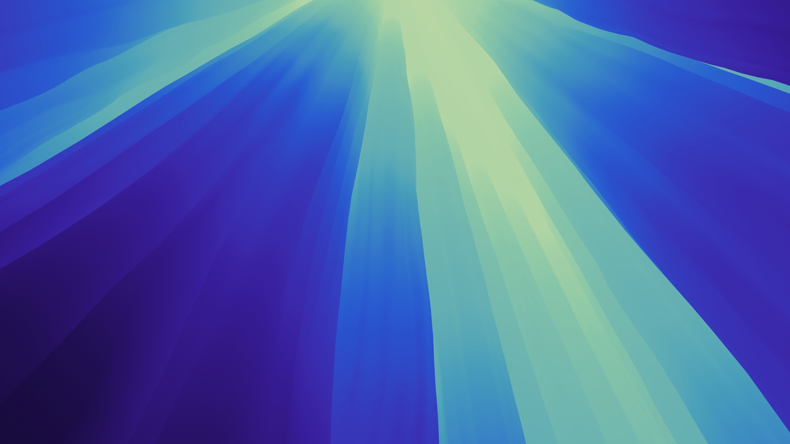
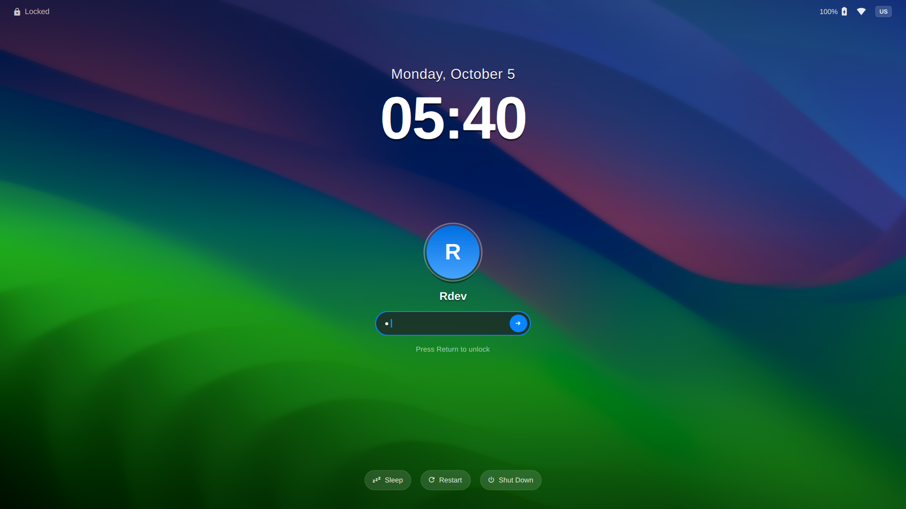
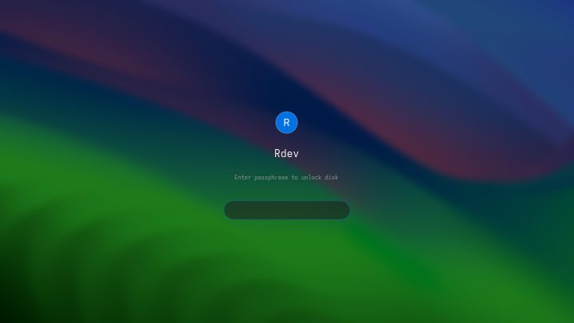
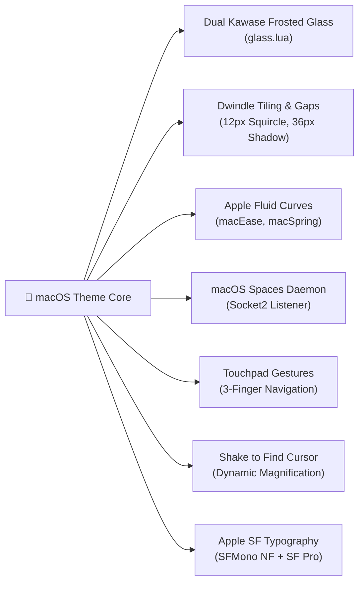

<div align="center">

#  macOS Sequoia for Omarchy & Hyprland

### *The Definitive, Pixel-Perfect Apple Experience Engineered for Modern Wayland Desktop*

[](https://archlinux.org/)
[](https://hyprland.org/)
[](https://omarchy.org/)
[](LICENSE)
[](https://github.com/ayush-rdev/omarchy-macos-theme/stargazers)

<br/>

```
        macOS Sequoia Aesthetic  •  Dual Kawase Frosted Glass  •  Native Spaces Physics  •  Retina 1px Rim
```

<br/>



<br/><br/>

| 🔒 **macOS Sonoma / Sequoia Lock Screen** | 🚀 **LUKS Disk Decryption Boot UI** |
| :---: | :---: |
|  |  |

</div>

---

## ⚡ 1-Command Automated Installation

Transform your desktop into an authentic Apple macOS Sequoia environment with a single terminal command. Zero manual configuration, zero dependency headaches.

```bash
curl -fsSL https://raw.githubusercontent.com/ayush-rdev/omarchy-macos-theme/master/install.sh | bash
```

> [!TIP]
> **What the installer automates:**
> 1. Clones and stages the complete macOS Sequoia theme into Omarchy without stripping Lua scripts.
> 2. Deploys the high-efficiency Dual Kawase frosted glass blur and translucent window rules.
> 3. Installs all helper scripts (`omarchy-toggle-fullscreen-space`, `omarchy-spaces-listener`, `omarchy-glass-toggle`, `omarchy-window-hide`, `toggle-window-switcher`) to `~/.local/bin/`.
> 4. Activates the background Spaces auto-cleanup and return daemon via systemd user service.
> 5. Binds all macOS keybindings, window rules, and 3-finger horizontal touchpad gestures.
> 6. Deploys the dynamic cursor plugin for macOS "Shake to Find" magnification.
> 7. Installs `Liga SFMono Nerd Font` & Apple SF Pro typography.
> 8. Applies your default 4K **Sonoma Horizon** wallpaper and reloads the desktop live.

---

## 💎 Architectural Highlights



### 1. 🪟 High-Efficiency Dual Kawase Frosted Glass
* **Dual Kawase 2-Pass Shader Blur**: Maximum creamy optical diffusion with minimal pixel sampling overhead, keeping thermals low and frame latency under 0.8ms.
* **Intelligent Occlusion Cipping**: `new_optimizations = true` skips rendering blur behind opaque window regions, saving GPU fill-rate.
* **Dynamic Glass Toggle**: Press <kbd>Super</kbd> + <kbd>Alt</kbd> + <kbd>Backspace</kbd> to toggle between frosted translucent glass and solid high-contrast mode in real-time.
* **Layer Surface Diffusion**: Applies blur across the Omarchy status bar, popup panels, notification center, clipboard manager, and OSD.

### 2. 🎯 Retina 1px Glass Rim Borders & Drop Shadows
* **Active Glow Rim**: 1px gradient hairline border at 45° transitioning from Apple Blue (`#0a84ff`) to Electric Cyan (`#64d2ff`) with translucent alpha channel (`rgba(0a84ffb8)` ➔ `rgba(64d2ff98)`).
* **Inactive Glass Rim**: Subtle frosted glass reflection border (`rgba(ffffff12)`).
* **Directional Drop Shadows**: 36px wide ambient downward shadow (`offset = { 0, 6 }`, `render_power = 4`) reproducing macOS elevation depth.

### 3. 📐 Golden Ratio Dwindle Tiling & Proportions
* **Top Bar Alignment Gaps**: Calibrated `gaps_out = { top = 5, right = 10, bottom = 10, left = 10 }` and `gaps_in = 6` for a tight 5px clearance beneath the menu bar.
* **12px Squircle Corners**: Exact Apple continuous curve curvature radius.

### 4. 🌊 Apple Spring & Deceleration Physics
Faithfully calibrated cubic-bezier animation equations extracted from macOS Sequoia window server:
* `macEase` — `cubic-bezier(0.16, 1.0, 0.3, 1.0)`: Signature fluid deceleration for window borders and layers.
* `macSpring` — `cubic-bezier(0.05, 0.9, 0.1, 1.04)`: Subtle overshoot physics giving responsive life to opening windows.
* `macQuick` — `cubic-bezier(0.25, 1.0, 0.5, 1.0)`: Instantaneous responsive curve for tooltips and menus.
* `macSpace` — `cubic-bezier(0.2, 0.8, 0.2, 1.0)`: Gliding horizontal slide curve for spaces switching.

### 5. 🚀 Native macOS Spaces Architecture
* **Single-Window Fullscreen Spaces**: Toggle windows into clean dedicated fullscreen spaces (<kbd>Super</kbd> + <kbd>F</kbd> or 3-finger click) with zero window bounce.
* **Socket2 Auto-Cleanup Daemon**: An event-driven background listener monitors the Hyprland IPC socket. When a dedicated space window closes, the daemon automatically destroys the empty workspace and slides you seamlessly back to your previous active workspace.

### 6. 🖐️ Fluid 3-Finger Touchpad Gestures
* **3-Finger Horizontal Swipe ↔**: Glides smoothly between active workspaces with Apple slide curves.
* **3-Finger Swipe Up ↑**: Opens the Spotlight-inspired fuzzy window switcher.
* **3-Finger Swipe Down ↓**: Dismisses/closes the active window.

### 7. 🖱️ macOS "Shake to Find" Dynamic Cursor
* Rapidly shaking your pointer across the display dynamically magnifies the cursor up to 5.5× and gracefully shrinks it back down when stationary — powered by the zero-distortion `dynamic-cursors` engine.

### 8. 🔍 macOS Quick Look File Previews (`Spacebar`)
* Integrated GNOME Sushi patched with authentic macOS borderless floating styling. Press <kbd>Spacebar</kbd> in Nautilus on any image, video, PDF, document, or audio file to preview instantly; tap <kbd>Spacebar</kbd> or <kbd>Esc</kbd> to dismiss.

### 9. 🎨 17 Curated 4K Apple Wallpapers
* Bundled with all iconic 4K dynamic light and dark wallpapers from Sequoia, Sonoma Horizon, Lake Tahoe, Mojave Night, Catalina Island, Ventura, Monterey, and Big Sur.

---

## ⌨️ Complete Keybindings & Gestures Cheat-Sheet

### 🪟 Window Management & Glass Effects
| Action | Shortcut / Trigger | Description |
| :--- | :--- | :--- |
| **Toggle Glass Blur** | <kbd>Super</kbd> + <kbd>Alt</kbd> + <kbd>Backspace</kbd> | Toggles Dual Kawase frosted glass & translucency on/off |
| **Dedicated Space** | <kbd>Super</kbd> + <kbd>F</kbd> *(or 3-finger click)* | Moves window into a dedicated single-app space |
| **Exit Dedicated Space** | <kbd>Super</kbd> + <kbd>F</kbd> | Returns window back to its origin workspace |
| **Traditional Fullscreen** | <kbd>Super</kbd> + <kbd>Alt</kbd> + <kbd>F</kbd> | Maximizes window inside current workspace |
| **Hide Window** | <kbd>Super</kbd> + <kbd>H</kbd> | Minimizes active window to scratchpad |
| **Unhide Window** | <kbd>Super</kbd> + <kbd>Alt</kbd> + <kbd>H</kbd> | Restores minimized window to current workspace |
| **Close All in Space** | <kbd>Super</kbd> + <kbd>Alt</kbd> + <kbd>W</kbd> | Closes every open window on the active workspace |
| **Quick Look Preview** | <kbd>Spacebar</kbd> *(in Nautilus)* | Instant floating preview for images, PDFs, code, media |

### 🧭 Navigation & Gestures
| Action | Shortcut / Gesture | Description |
| :--- | :--- | :--- |
| **Slide Workspaces** | **3-Finger Swipe Horizontal ↔** | Glides between spaces with Apple inertia |
| **Next Workspace** | <kbd>Super</kbd> + <kbd>Tab</kbd> | Cycles to next workspace |
| **Spotlight Window Switcher** | **3-Finger Swipe Up ↑** | Fuzzy window selector across all spaces |
| **Close Active Window** | **3-Finger Swipe Down ↓** | Closes / dismisses focused window |
| **Move Window & Follow** | <kbd>Super</kbd> + <kbd>Alt</kbd> + <kbd>1-9</kbd> | Moves window to space `1-9` and switches focus |
| **Move Window Silently** | <kbd>Super</kbd> + <kbd>Shift</kbd> + <kbd>1-9</kbd> | Moves window to space `1-9` without following |

### 🛠️ Utilities & System Panels
| Action | Shortcut | Description |
| :--- | :--- | :--- |
| **Clipboard History** | <kbd>Super</kbd> + <kbd>V</kbd> | Opens Quickshell clipboard manager |
| **Screen Capture Menu** | <kbd>Super</kbd> + <kbd>Alt</kbd> + <kbd>C</kbd> | Opens screenshot & recording menu |
| **Extract Text (OCR)** | <kbd>Super</kbd> + <kbd>Alt</kbd> + <kbd>Print</kbd> | Captures region text directly to clipboard |
| **Shake to Find** | **Rapid mouse shake** | Enlarges cursor pointer dynamically |

---

## 🖼️ Wallpaper Management

The theme ships with 17 high-resolution macOS wallpapers pre-indexed into Omarchy's background engine:

```bash
# Cycle to next wallpaper
omarchy theme bg next

# Open the visual GUI wallpaper picker
omarchy menu wallpaper

# Set a specific wallpaper
omarchy theme bg set ~/.local/state/omarchy/current/theme/backgrounds/7-sonoma-horizon.png
```

---

## 📂 Architecture & File Hierarchy

```
~/.config/omarchy/themes/macos/
├── colors.toml               # Palette, Retina 1px Apple border tokens
├── shell.toml                # Top bar, launcher, popups, and OSD styling
├── hyprland.lua              # Dwindle tiling, 12px squircle, drop shadows, curves
├── glass.lua                 # Dual Kawase blur & window opacity rules
├── icons.theme               # WhiteSur macOS dark icon pairing
├── alacritty.toml            # Alacritty terminal theme
├── foot.ini                  # Foot terminal theme
├── ghostty.conf              # Ghostty terminal theme
├── kitty.conf                # Kitty terminal theme
├── macOS-Sequoia.tdesktop    # Telegram Desktop Sequoia theme
├── backgrounds/              # 17 High-Resolution 4K macOS Wallpapers
├── lock-designs/             # Native macOS Sonoma & Sequoia Lock Screens
├── boot-designs/             # LUKS disk decryption boot layout
├── patches/                  # GNOME Sushi Quick Look borderless UI patch
├── plugins/                  # Dynamic Cursors plugin binary
└── scripts/                  # macOS window & space management utilities
    ├── omarchy-glass-toggle
    ├── omarchy-toggle-fullscreen-space
    ├── omarchy-spaces-listener
    ├── omarchy-close-workspace-windows
    ├── omarchy-window-hide
    └── toggle-window-switcher
```

---

## 🛠️ Manual Installation (For Power Users)

If you prefer to configure manually without running the 1-command installer:

```bash
# 1. Clone repository
git clone https://github.com/ayush-rdev/omarchy-macos-theme.git ~/.config/omarchy/themes/macos

# 2. IMPORTANT: Remove .git so Omarchy treats it as a user-authored theme
rm -rf ~/.config/omarchy/themes/macos/.git

# 3. Copy helper scripts to PATH
cp -f ~/.config/omarchy/themes/macos/scripts/* ~/.local/bin/
chmod +x ~/.local/bin/omarchy-* ~/.local/bin/toggle-window-switcher

# 4. Deploy frosted glass configuration
cp -f ~/.config/omarchy/themes/macos/glass.lua ~/.config/hypr/glass.lua
mkdir -p ~/.local/state/omarchy/toggles/hypr
cp -f ~/.config/hypr/glass.lua ~/.local/state/omarchy/toggles/hypr/glass.lua
omarchy bar transparent true

# 5. Enable Spaces background listener service
cat << 'EOF' > ~/.config/systemd/user/omarchy-spaces-listener.service
[Unit]
Description=macOS Spaces Auto-Clean & Return daemon for Hyprland
PartOf=graphical-session.target
After=graphical-session.target

[Service]
Type=simple
ExecStart=%h/.local/bin/omarchy-spaces-listener
Restart=always

[Install]
WantedBy=graphical-session.target
EOF

systemctl --user daemon-reload
systemctl --user enable --now omarchy-spaces-listener.service

# 6. Apply theme
omarchy theme set macos
hyprctl reload
```

---

## 🧹 Complete Uninstallation

To restore your system to defaults and remove all scripts, services, and plugins:

```bash
curl -fsSL https://raw.githubusercontent.com/ayush-rdev/omarchy-macos-theme/master/uninstall.sh | bash
```

---

## 🤝 Community & Credits

* Engineered with ❤️ for the [Omarchy](https://omarchy.org/) Linux distribution.
* Blur physics based on the Dual Kawase filter algorithm.
* Shake-to-find dynamic cursor powered by [virtcode/hypr-dynamic-cursors](https://github.com/virtcode/hypr-dynamic-cursors).
* Quick Look file previews powered by [GNOME Sushi](https://gitlab.gnome.org/GNOME/sushi).
* Ligaturized Apple SFMono font by [shaunsingh](https://github.com/shaunsingh/SFMono-Nerd-Font-Ligaturized).

<div align="center">

**[⬆ Back to Top](#-macos-sequoia-for-omarchy--hyprland)**

</div>
